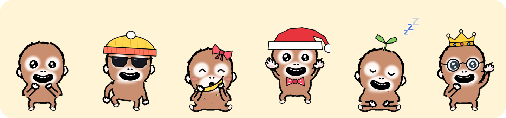
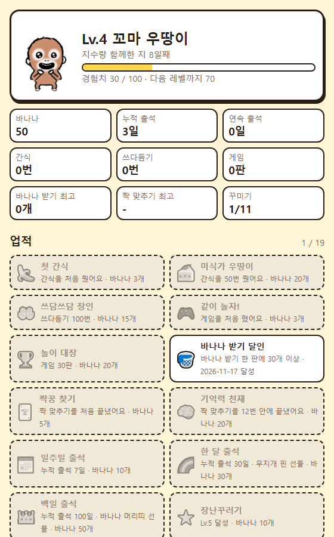
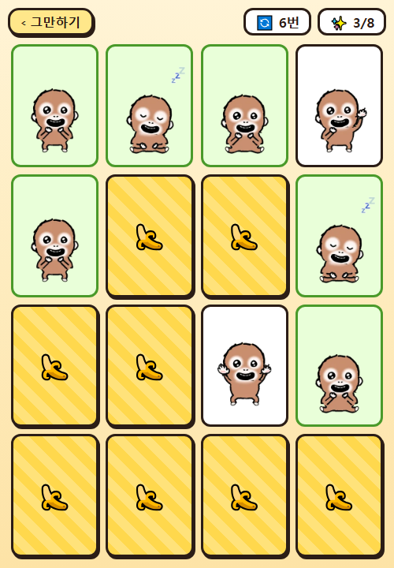

# 우땅이



**바탕화면을 돌아다니는 작은 원숭이 우땅이**예요.
걷고, 앉고, 졸고, 간식을 먹고, 이름을 불러 주고, 시간 맞춰 말을 걸어요.
바나나를 모아 간식을 주고 모자도 씌워 주면서 함께 레벨을 올려 보세요.

### ⬇️ [설치 프로그램 내려받기 (v1.2)](https://github.com/yungi1013-netizen/woottangi/releases/latest/download/Woottangi_Setup_v1.2.exe)

Windows 10/11 · 관리자 권한 필요 없음. 설치하면 시작 메뉴·바탕화면에 "우땅이"가 생기고, 설정 > 앱 에서 지울 수 있어요.
설치 없이 쓰고 싶다면 [포터블 zip](https://github.com/yungi1013-netizen/woottangi/releases/latest/download/Woottangi_v1.2_portable.zip) 을 받아 압축을 풀고 실행하세요.
처음 실행할 때 SmartScreen 경고가 뜨면 **추가 정보 → 실행**을 눌러 주세요 (서명하지 않은 exe라서 그래요).

### 📱 [안드로이드 앱 내려받기 (v1.2 APK)](https://github.com/yungi1013-netizen/woottangi/releases/latest/download/Woottangi_Android_v1.2.apk)

폰 화면 위를 우땅이가 돌아다녀요 (다른 앱 위에 표시 권한 필요). 휴대폰에서 받아 설치하고, "출처를 알 수 없는 앱" 설치를 허용해 주세요.
이미 깔려 있으면 그대로 덮어 설치하면 돼요. 바나나 · 레벨 · 꾸미기 · 업적 기록은 그대로 남아요.

## 할 수 있는 것

우땅이를 **우클릭**하면 메뉴가 열려요.

| | |
|---|---|
| 🍌 **간식 주기** | 바나나 · 바나나우유 · 바나나케이크. 배부름과 기분이 올라가요 |
| 🎀 **꾸미기** | 바나나로 모자·고양이 귀·토끼 귀·밀짚모자·안경·볼터치·진주 목걸이 등 17가지를 사서 씌워요 (PC·안드로이드 앱). 코디 3칸 저장 · 오늘의 코디(랜덤). 걷든 자든 머리를 따라다녀요 |
| 🎮 **놀아주기** | 바나나 받기 · 짝 맞추기 · 바나나 탑 쌓기 · 우땅이 두더지 잡기 미니게임으로 바나나를 모아요 |
| 💬 **AI 대화 (새로!)** | 메뉴 → 우땅이랑 대화하기. 말을 걸면 우땅이가 Claude로 대답하고 어울리는 동작도 해요. 내 Anthropic API 키를 넣어야 켜지고 (사용 요금은 내 계정), 키가 없어도 지금처럼 잘 놀아요 |
| 😊 **이모티콘** | 브이 · 엄지척 · 노래 · 꽃받침 등 20가지가 넘는 동작. GIF로 저장해서 메신저로 보낼 수도 있어요 |
| 🍳 **바나나 요리** | 바나나로 요리를 만들어 요리 도감을 채워요 |
| 🎶 **음악 춤** | 컴퓨터·폰에서 음악이 나오면 우땅이가 들썩들썩 춤을 춰요 |
| ⭐ **레벨·칭호** | 함께할수록 경험치가 쌓여 아기 우땅이 → 단짝 → 베프 → 전설의 우땅이… |
| 📅 **출석 도장** | 매일 바나나, 7일 연속 보너스, 누적 30·100일엔 특별 아이템 선물 |
| 🏆 **업적 50개 이상** | 달성하면 우땅이가 축하하고 바나나를 줘요. 몇몇 업적은 특별한 꾸미기 아이템(꽃 화관·금메달·헤드폰·요리사 모자…)도 선물해요 |
| 📒 **우땅이 수첩** | 기록 · 업적 · 꾸미기 도감을 한눈에 |
| ⏱️ **집중 타이머** | 25분·50분 집중하는 동안 옆에 조용히 앉아 있다가, 끝나면 바나나를 줘요 |
| 🫧 **씻기기 · 재우기** | 놀다 보면 꼬질꼬질해져요. 마우스로 문질러 거품 목욕을 시키고, 졸려 하면 이불을 덮어 재워요 |
| 🌸 **계절 · 기념일** | 겨울엔 눈, 봄엔 벚꽃잎, 여름엔 비눗방울, 가을엔 낙엽이 가끔 화면 가득 내려요. 크리스마스·설날·할로윈 같은 날엔 특별 인사와 선물 아이템 |
| 📔 **그림일기** | 하루 동안 함께한 일을 우땅이가 일기로 써서 수첩에 모아 둬요 |
| 🧺 **바탕화면 놀이** | 화면 위에서 떨어지는 바나나를 우땅이로 받기, 화면 끝·창 뒤에 숨은 우땅이 찾기(숨바꼭질), 바나나 뽑기(뽑기 전용 아이템 4종) |
| 🥜 **친구 땅콩이** | Lv.5부터 친구 땅콩이가 가끔 놀러 와서 같이 웃고, 산책하고, 술래잡기하고, 바나나도 나눠 먹어요 |
| 💡 **생활 도우미** | 오래 쓰면 스트레칭·물 마시기 알림, 노트북 배터리 반응, 포스트잇 메모 배달, 효과음 (모두 켜고 끌 수 있어요) |
| 🖥️ **여러 모니터** | 설정 → 다닐 모니터에서 체크한 모니터끼리 걸어서·날아서 넘어가요 |
| ⚙️ **설정** | 크기 · 투명도 · 걷는 속도 · 전체화면일 때 숨기 · 자동 실행 |
| 🔮 **오늘의 운세** · 🤲 **쓰다듬기** · ⏰ **시간 알림** | 그 밖에 소소한 즐거움 |

<p>


</p>

클릭하면 반응하고, 마우스를 가까이 대면 쳐다보며 수줍어해요.
끌어서 **휙 던지면** 날아가 벽에 튕기고 통통 튀다 착지하고, **창 제목줄 위에 떨어뜨리면** 그 위에 올라앉아 창을 옮길 때 같이 움직여요.
게임·영상·발표처럼 전체화면일 때는 알아서 숨고, 새벽엔 졸고, 기분이 나쁘면 터벅터벅 걸어요.
트레이 아이콘을 누르면 화면 가운데로 불러올 수 있어요.

- 저장 위치: `%AppData%\Woottangi\` (이름 · 바나나 · 기록)
- 휴대폰용 "우땅이 키우기"는 [`web/woottangi_mobile.html`](web/woottangi_mobile.html) 한 파일이에요. 내려받아 휴대폰 브라우저로 열면 돼요. 레벨·꾸미기·업적·수첩·짝 맞추기·집중 타이머·씻기기·재우기·계절 이벤트·그림일기·숨바꼭질·바나나 뽑기·친구 땅콩이·효과음도 있어요 (기록은 휴대폰에 따로 저장. 여러 모니터·바탕화면 바나나 받기·메모·건강 알림은 PC 전용).

---

# 개발자용: 소스와 빌드

바탕화면을 돌아다니는 우땅이(PC)와 휴대폰용 "우땅이 키우기" 웹앱의 전체 소스입니다.
제작: K

- **그림(프레임)은 Python**으로 만듭니다. 원본 머리 + 그린 몸 → 480×600 PNG
- **PC 프로그램은 Go**(Win32, cgo 없음)로 만들어 exe 하나로 나옵니다. 프레임은 exe 안에 들어갑니다.
- **휴대폰용은 HTML 한 파일**입니다. 프레임이 WebP로 안에 들어갑니다.

## 폴더 구조

```
Woottangi_source/
├─ build.py               전체 빌드 (아래 "빌드 방법")
├─ requirements.txt       파이썬 패키지 목록
├─ assets/                원본 그림
│  ├─ head_full.png        원본 머리 (정체성 — 이 얼굴은 그대로 유지)
│  ├─ head_*.png           표정 머리 (heads.py 가 만든 것: 먹기·수줍음·벌받기·깜빡·잠)
│  ├─ fistL/R, palmL/R     주먹·손바닥
│  └─ stickers/            이모티콘 스티커 5종 (고해상도)
├─ tools/                 파이썬 도구
│  ├─ heads.py             표정 머리 만들기 (눈·입 inpaint 후 새로 그림)
│  ├─ compose.py           동작 프레임 합성 (걷기·앉기·자기·웃기·먹기·벌서기 … + 이모티콘: 박수·화이팅·사랑해·흥·춤·갸우뚱)
│  ├─ stickers.py          스티커 동작 프레임 (놀람·뒹굴·울기·저요·인사)
│  ├─ accessories.py       꾸미기 아이템 그림(pc/acc) + 프레임별 머리 위치(pc/anchors.go)
│  ├─ effects.py           계절 날씨 조각 · 거품 · 반짝이 · 이불 그림 (pc/fx)
│  ├─ build_web.py         휴대폰 HTML + PC 게임 페이지 만들기
│  └─ make_res.py          exe 아이콘·버전정보(.syso) 만들기
├─ frames/                완성 프레임 128장 (위 도구들의 결과물)
├─ pc/                    PC 프로그램 (Go)
│  ├─ main.go              창·애니메이션·이동·드래그·우클릭 메뉴
│  ├─ talk.go              말풍선·이름 묻기·시간대 대사·클릭/밥/쓰다듬기/혼내기
│  ├─ state.go             바나나·배부름·기분·간식·출석·운세·바나나 받기 게임
│  ├─ notify.go            트레이 아이콘·윈도우 알림·시간 알림·배고픔 알림
│  ├─ shop.go              꾸미기 상점 · 코디 저장 · 오늘의 코디
│  ├─ level.go             레벨·친밀도 (경험치·칭호·레벨 업 보상·함께한 날·기념일·친밀도 대사)
│  ├─ move.go              던지기·튕기기 · 창 위에 앉기 · 마우스 반응 · 전체화면일 때 숨기 · 밤/기분 행동
│  ├─ focus.go             집중 타이머 (25·50분)
│  ├─ care.go              돌봄: 꼬질꼬질 · 씻기기(문지르기) · 졸림 · 이불 덮어 재우기
│  ├─ season.go            계절 날씨 쇼 · 날짜 이벤트(설날·추석·크리스마스…) · 선물 아이템
│  ├─ diary.go             그림일기 (하루 기록 → 우땅이 말투 일기)
│  ├─ fx.go                효과 조각 그리기 (우땅이 주변 거품 · 화면 전체 날씨 창)
│  ├─ play.go              바탕화면 바나나 받기 · 숨바꼭질 · 바나나 뽑기
│  ├─ friend.go            친구 땅콩이 (놀러 와서 같이 놀다 감)
│  ├─ helper.go            건강 알림 · 배터리 반응 · 포스트잇 메모 · 효과음
│  ├─ monitor.go           여러 모니터 (다닐 모니터 고르기 · 모니터 넘어가기)
│  ├─ settings.go          설정 메뉴 (크기·투명도·걷는 속도·전체화면 숨기, 저장됨)
│  ├─ ach.go               업적 · 업적 보상 아이템 · 누적 출석 선물(30·100일) · 업데이트 소식 · 우땅이 수첩(/book)
│  ├─ ai.go · chat.html    AI 대화 (Claude, 사용자 API 키) · 대화 창 페이지
│  ├─ emo.go               이모티콘 메뉴 · GIF 저장
│  ├─ cook.go              바나나 요리 · 요리 도감
│  ├─ music.go             음악 감지 (윈도우 오디오 미터) → 춤
│  ├─ whack_template.html  우땅이 두더지 잡기 (build_web.py 가 whack.html 로 만듦)
│  ├─ match_template.html  짝 맞추기 게임 화면 (build_web.py 가 match.html 로 만듦)
│  ├─ anchors.go           프레임별 머리 위치 (accessories.py 가 자동 생성)
│  ├─ acc/                 꾸미기 아이템 그림 (accessories.py 결과)
│  ├─ shop_test.go         go test → 상점 동작 확인 + test_worn.png 미리보기
│  └─ game_template.html   바나나 받기 게임 화면 (build_web.py 가 game.html 로 만듦)
├─ installer/            설치 프로그램 (Go) — 설치·업데이트·삭제, build.py setup 으로 만듦
├─ android/              안드로이드 앱 (Java, Gradle 없이 tools/build_android.py 로 APK 빌드)
│  ├─ src/…/Pet.java       우땅이 상태·행동 (PC 와 같은 규칙) · AI 답 다듬기
│  ├─ src/…/PetService.java  화면 위 우땅이 (다른 앱 위에 표시) · 꾹 메뉴
│  ├─ src/…/AiChat.java    AI 대화 (Messages API 를 HttpURLConnection 으로 직접 호출)
│  └─ test/PetTest.java    python tools/build_android.py --test
├─ web/
│  ├─ template.html        휴대폰용 화면 원본
│  └─ woottangi_mobile.html  완성본 (build_web.py 결과)
└─ dist/Woottangi.exe     완성 exe (build.py 결과)
```

## 준비물

```
pip install -r requirements.txt
python -m playwright install chromium     # compose.py 가 SVG를 그릴 때 사용
```
PC exe 를 만들려면 Go 1.22 이상 (https://go.dev/dl). 윈도우·맥·리눅스 어디서든 윈도우용 exe 가 만들어집니다.

## 빌드 방법

| 명령 | 하는 일 |
|---|---|
| `python build.py` | 지금 frames/ 그대로 → 휴대폰 HTML + exe |
| `python build.py frames` | 프레임만 처음부터 다시 그림 (표정 → 동작 → 스티커) |
| `python build.py web` | 휴대폰 HTML + 게임 페이지만 |
| `python build.py exe` | exe 만 |
| `python build.py all` | 전부 처음부터 (+ 배포 파일) |
| `python build.py setup` | **배포용**: exe + 설치 프로그램 `dist/Woottangi_Setup_v{버전}.exe` + 압축 파일 `dist/Woottangi_v{버전}_portable.zip` |
| `python tools/build_android.py` | 안드로이드 APK `dist/Woottangi_Android_v{버전}.apk` (JDK 17 + Android SDK, 서명 키는 저장소 밖에 둠) |

설치 프로그램(`installer/`)은 관리자 권한 없이 `%LOCALAPPDATA%\Programs\Woottangi` 에 설치하고,
시작 메뉴·바탕화면 바로가기와 "설정 > 앱" 제거 항목을 만듭니다. 이미 설치돼 있으면 업데이트하고, 기록(`%AppData%\Woottangi`)은 그대로 둡니다.
`/S` 조용히 설치 · `uninstall.exe /uninstall /S` 조용히 삭제 (`/PURGE` 를 붙이면 기록도 삭제). 버전은 `build.py` 의 `VERSION`.

동작 하나만 다시 그려 보려면:
```python
import sys; sys.path.insert(0, "tools")
import compose
from playwright.sync_api import sync_playwright
with sync_playwright() as p:
    pg = p.chromium.launch().new_page(viewport={"width": 480, "height": 600})
    compose.make(pg, "eat_milk", 0.25).save("test.png")
```

## 자주 고칠 곳

| 바꾸고 싶은 것 | 위치 |
|---|---|
| 시간대 대사 (9시 좋은 아침 등) | `pc/talk.go` → `var slots` |
| 평소 혼잣말 / 클릭했을 때 말 | `pc/talk.go` → `randomLine()`, `clickLine()` |
| 간식 종류·가격·효과 | `pc/state.go` → `var snacks` / 휴대폰은 `web/template.html` → `SNACKS` |
| 경험치 양 · 레벨 곡선 · 칭호 · 친밀도 대사 | `pc/level.go` → `exp*`, `expNeed()`, `var titles`, `affectionLine()` |
| 업적 (조건·보상·선물 아이템) | `pc/ach.go` → `var achievements` |
| 짝 맞추기 카드 그림 / 보상 | `tools/build_web.py` → `poses` / `pc/state.go` 의 `26-moves` (페이지 `reward()` 도 같이) |
| 꾸미기 아이템 이름·가격·대사 | `pc/shop.go` → `var items` |
| 꾸미기 아이템 그림 / 새 아이템 | `tools/accessories.py` → 그림 함수 + `ITEMS` (그 뒤 `python tools/accessories.py`) |
| 날짜 이벤트 (날짜 · 인사 · 선물) / 설날·추석 날짜 | `pc/season.go` → `events`, `lunarDays` (휴대폰은 `web/template.html` 의 `EVENTS`, `LUNAR`) |
| 날씨 쇼 종류 · 양 · 속도 / 얼마나 자주 | `pc/fx.go` → `weathers` / `pc/season.go` → `showGap()` |
| 꼬질꼬질 · 졸림이 쌓이는 빠르기 | `pc/care.go` → `careMinute()` |
| 바나나 뽑기 값 · 확률 · 뽑기 아이템 | `pc/play.go` → `gachaCost`, `gachaTick()`, `gachaPool` (휴대폰은 `GACHA`) |
| 친구가 오는 레벨 · 간격 | `pc/friend.go` → `friendLevel`, `nextFriendAt` |
| 스트레칭 · 물 알림 간격 | `pc/helper.go` → `stretchEvery`, `waterEvery` |
| 아이템이 머리에서 어긋나는 스티커 동작 | `tools/accessories.py` → `STICKER0` (`preview` 로 확인) |
| 오늘의 운세 문구 | `pc/state.go` → `var luck` / 휴대폰은 `web/template.html` → `LUCK` |
| 기본 크기 (작게 0.75) | `pc/main.go` → `scale = 0.75` |
| 동작 프레임 수 | `tools/compose.py` → `SEQ` |
| 몸·팔·다리 모양 | `tools/compose.py` → `pose()`, `pose_eat()`, `pose_emo()` (이모티콘) |
| 버전 (지금 1.2) | `build.py` → `VERSION` 한 곳만 (exe 메뉴·트레이·파일 정보·설치 프로그램에 모두 들어감. README 다운로드 링크의 파일 이름도 같이) |

## 저장 위치 (PC)

`%AppData%\Woottangi\`
- `name.txt` 주인 이름
- `state.json` 바나나·배부름·기분·출석·설정
- `reminders.json` 시간 알림 목록

휴대폰용은 브라우저 저장소(localStorage)에 저장됩니다.

## 참고

- `stickers.py` 는 정리하면서 다시 작성한 것이라, 처음 만든 스티커 프레임과 움직임이 아주 조금 다를 수 있습니다. 지금 `frames/` 에 들어 있는 것은 실제 exe 에 쓰인 원본입니다.
- 나머지 도구(`heads.py`, `compose.py`)는 지금 `frames/` 와 똑같은 그림을 다시 만들어 냅니다.
